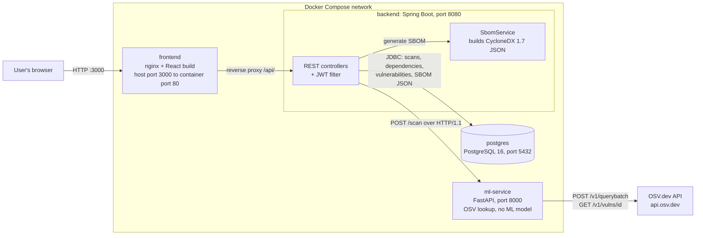
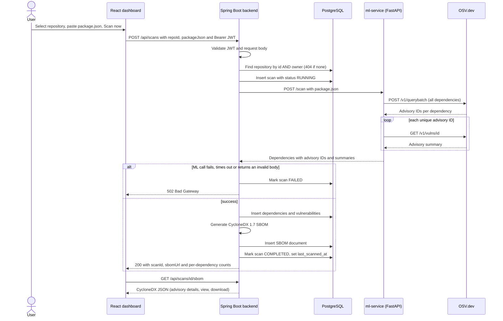
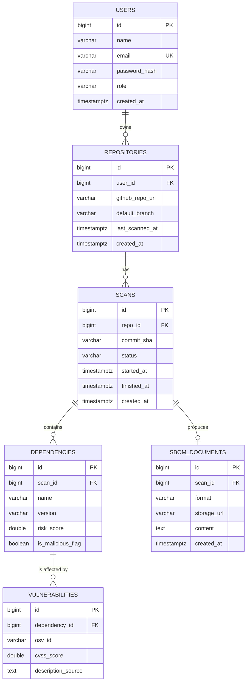

# SentraShield — An AI-Powered npm Supply Chain Security Copilot

SentraShield scans the npm dependencies of a project against the [OSV.dev](https://osv.dev) vulnerability database, stores the results per user, generates a [CycloneDX](https://cyclonedx.org) Software Bill of Materials (SBOM) for every scan, and presents everything in a web dashboard.

> **Project status: functional prototype under active development.**
> The implemented system is the secure scanning, SBOM and dashboard foundation. The machine-learning classifier, LLM explanations and GitHub integration described in the original project proposal are **planned future work and are not implemented** — see [Implemented Features](#4-implemented-features) and [Current Status and Future Improvements](#9-current-status-and-future-improvements).

---

## Table of Contents

1. [Project Overview](#1-project-overview)
2. [Technology Stack](#2-technology-stack)
3. [Architecture](#3-architecture)
4. [Implemented Features](#4-implemented-features)
5. [Installation and Execution](#5-installation-and-execution)
6. [API Documentation](#6-api-documentation)
7. [Database and Security](#7-database-and-security)
8. [Testing and Verification](#8-testing-and-verification)
9. [Current Status and Future Improvements](#9-current-status-and-future-improvements)
10. [Academic Presentation](#10-academic-presentation)

---

## 1. Project Overview

### The npm supply-chain security problem

A typical Node.js project depends on hundreds of npm packages, directly and transitively, and developers rarely audit them beyond checking that the build passes. Attackers exploit that trust by publishing malicious or typosquatted packages, compromising maintainer accounts, or shipping vulnerable releases of popular libraries. Knowing *which* versions a project uses, and *which known advisories* affect them, is the first step towards managing that risk. Regulation and industry practice increasingly expect this inventory to exist as an SBOM.

### What SentraShield does

1. A user signs in and registers a repository (a GitHub URL used as a label).
2. The user submits that project's `package.json` — pasted or loaded from a file in the dashboard.
3. SentraShield extracts the declared dependencies and queries OSV.dev for known advisories affecting each exact version.
4. Results are stored in PostgreSQL, tied to the user who owns the repository.
5. A CycloneDX 1.7 SBOM — components plus the vulnerabilities that affect them — is generated and stored for the scan.
6. The dashboard shows the risk summary, per-dependency advisory details, and lets the user view or download the SBOM.

### How OSV.dev is used

The scan service (`ml-service`) makes two kinds of calls to the public OSV API:

- `POST https://api.osv.dev/v1/querybatch` — one request containing every `{package, ecosystem: npm, version}` pair from the manifest. OSV answers with advisory **IDs only**.
- `GET https://api.osv.dev/v1/vulns/{id}` — once per unique advisory ID, to fetch the advisory summary text.

Only the advisory ID and summary are stored today (CVSS scores are not extracted yet).

### How the SBOM is generated

After a scan, the backend's `SbomService` builds a CycloneDX **1.7** JSON document: a `metadata.component` for the scanned repository, one `library` component per dependency (with a `pkg:npm/<name>@<version>` package URL), and one entry in `vulnerabilities` per advisory with an `affects` reference to the affected component. The JSON is stored as text in PostgreSQL and served through the API as `application/vnd.cyclonedx+json`. The document is built from plain Java records; no CycloneDX library is used.

### Scope clarifications

- **No machine learning is part of the live scan pipeline.** The Python service is named `ml-service` because it is the planned home of the classifier, but today it only parses `package.json` and queries OSV. Its dependencies are `fastapi`, `uvicorn` and `httpx` — no ML library is installed.
- **SentraShield never contacts GitHub.** The repository URL is a label; the `package.json` content is supplied by the user.
- **Only direct dependencies** declared in `package.json` (`dependencies` and `devDependencies`) are scanned. Transitive dependencies and lockfiles are not analysed.

---

## 2. Technology Stack

Only technologies present in the repository are listed.

| Layer | Technology | Details |
|---|---|---|
| Backend | Java 21, Spring Boot 3.5.11 | Spring Web, Spring Data JPA, Spring Security, Actuator (health endpoint only) |
| Authentication | JWT + BCrypt | `jjwt` 0.13.0 for tokens; Spring's `BCryptPasswordEncoder` for password hashes |
| Database | PostgreSQL 16 | `postgres:16-alpine` image; schema managed by **Flyway** migrations (`ddl-auto: none`) |
| Scan service | Python 3.12, FastAPI, uvicorn, httpx | Directory `ml-service/`; queries OSV.dev. **No ML model.** |
| Vulnerability data | OSV.dev API | `v1/querybatch` and `v1/vulns/{id}` |
| SBOM | CycloneDX 1.7 (JSON) | Hand-built subset: metadata, components, vulnerabilities |
| Frontend | React 19, TypeScript, Tailwind CSS 4, Vite 7 | Single-page app; served by nginx in Docker |
| Web server | nginx (alpine) | Serves the built frontend and reverse-proxies `/api/` to the backend |
| Containers | Docker, Docker Compose | Four services: `postgres`, `ml-service`, `backend`, `frontend` |

---

## 3. Architecture

### Component diagram

Every connection below exists in the code.



### Scan workflow



If saving results or generating the SBOM fails after the ML call succeeded, the scan is marked `FAILED` and the API returns `500`.

### Project structure

```
sentrashield/
├── docker-compose.yml
├── README.md
├── backend/                      Spring Boot service (Java 21)
│   ├── Dockerfile                Multi-stage: Maven build, then JRE runtime
│   ├── pom.xml
│   └── src/main/
│       ├── java/com/sentrashield/backend/
│       │   ├── BackendApplication.java, HealthController.java
│       │   ├── config/           SecurityConfig, MlServiceConfig
│       │   ├── controller/       AuthController, RepositoryController, ScanController
│       │   ├── dto/              Request/response records, CycloneDx.java
│       │   ├── entity/           User, Repo, Scan, Dependency, Vulnerability, SbomDocument
│       │   ├── repository/       Spring Data JPA repositories
│       │   ├── security/         JwtService, JwtAuthFilter
│       │   └── service/          SbomService
│       └── resources/
│           ├── application.yml
│           └── db/migration/     V1__init_schema.sql, V2__add_sbom_content.sql
├── ml-service/                   FastAPI scan service (Python 3.12)
│   ├── Dockerfile
│   ├── requirements.txt
│   └── app/                      main.py (routes), models.py (Pydantic models)
└── frontend/                     React + TypeScript dashboard
    ├── Dockerfile                Multi-stage: Node build, then nginx
    ├── nginx.conf                Static files + /api/ reverse proxy
    ├── vite.config.ts            Dev-server proxy for /api
    └── src/                      App.tsx, Dashboard.tsx, api.ts, ui.ts, index.css, main.tsx
```

---

## 4. Implemented Features

### Status legend

| Label | Meaning |
|---|---|
| **Verified** | Exercised manually against the running Docker Compose stack, and the expected result was observed. |
| **Author-reported** | Performed by the project author; not independently re-checked while preparing this document. |
| **Build-checked** | Compiles / type-checks and builds, but has not been exercised in a browser. |
| **Unverified** | Implemented in code, but no test has been run. |
| **Not implemented** | Planned only. |

### Features

| Feature | How it works | Status |
|---|---|---|
| User registration and login | `POST /api/auth/register` and `/login`; returns a JWT | **Verified** (API) |
| JWT authentication, protected endpoints | `JwtAuthFilter` reads the Bearer token; everything except `/api/auth/**`, `/actuator/**` and `/error` requires authentication; missing/invalid token returns `401` | **Verified** |
| Password hashing | BCrypt; only the hash is stored | **Verified** (register-then-login round trip succeeds) |
| User-owned repositories | `POST` / `GET /api/repositories`, scoped to the authenticated user; re-adding the same URL returns the existing entry | **Verified** (API) |
| Ownership validation | Scans and SBOM reads look up records *by id and owner*; other users' records return `404` | **Verified** |
| npm dependency scan via OSV.dev | `POST /api/scans` → `ml-service` → OSV.dev | **Verified** |
| Scan status handling | `RUNNING` → `COMPLETED`, or `FAILED` when the ML service call fails | **Verified** (`COMPLETED`, and `FAILED` with `ml-service` stopped) |
| Failure paths: timeout, malformed ML response, persistence error | Mapped to `FAILED` with `502` / `500`; HTTP timeouts are 5 s connect, 30 s read | **Unverified** |
| Persistence of results | `scans`, `dependencies`, `vulnerabilities` tables | **Verified** |
| CycloneDX 1.7 SBOM generation and storage | `SbomService`; JSON stored in `sbom_documents.content` | **Verified** (generated and read back); schema conformance **Unverified** |
| SBOM retrieval and download | `GET /api/scans/{scanId}/sbom` (API); *View* and *Download* buttons (dashboard) | API **Verified**; dashboard buttons **Unverified** |
| React dashboard — startup and login | Docker-served frontend, login screen | **Author-reported** |
| React dashboard — repository list/add, scan, results, advisory details | See [Dashboard](#dashboard) | **Unverified** in browser; the TypeScript type-check and production build pass (**Build-checked**) |

### Dashboard

The React dashboard (`frontend/src`) provides:

- **Login / account creation** screen; the session is kept in the browser's `localStorage`, and an expired or rejected token returns the user to the login screen.
- **Repository list** and an **Add repository** form.
- **Scan now**: a `package.json` text area (pre-filled with a sample) or *Load a package.json file*.
- **Results**: totals (dependencies, dependencies with advisories, total advisories), a list sorted by advisory count with colour-coded badges, and expandable per-dependency advisory details with links to `osv.dev`.
- **SBOM actions**: *View SBOM* (pretty-printed) and *Download SBOM (CycloneDX JSON)*.

Severity colours are based on the **number of advisories** only. CVSS scores are not stored, and the UI says so. Advisory details are read from the SBOM, because the scan response carries only counts. Dashboard results show the latest scan only; there is no scan-history view.

### Planned in the proposal, not implemented

Machine-learning malicious-package / typosquat classifier; composite risk scoring; LLM-generated explanations and prompt-injection sanitisation; GitHub Action and pull-request comments; GitHub OAuth / API access; rate limiting; automated tests and CI.

---

## 5. Installation and Execution

Commands are for **Windows PowerShell** with **Docker Desktop** (Docker Compose v2) running.

### Prerequisites

- Docker Desktop with the `docker compose` command available.
- Free host ports **3000** (frontend), **8080** (backend), **8000** (ml-service) and **5432** (PostgreSQL).
- Internet access: the scan service calls `api.osv.dev`, and the first build downloads Maven, npm and pip dependencies.

### Get the code

The project snapshot reviewed for this document has no Git remote configured, so no clone URL is documented. If you host it in Git, clone and enter it with your own URL:

```powershell
git clone <YOUR-REPOSITORY-URL>
cd sentrashield
```

Otherwise extract the project archive and `cd` into the folder that contains `docker-compose.yml`.

### Build and start

```powershell
docker compose up --build -d
docker compose ps
```

The first build takes a few minutes. Compose starts `postgres` first and waits for its health check before starting `backend`.

| Service (Compose name) | URL on your machine | Notes |
|---|---|---|
| `frontend` | <http://localhost:3000> | Dashboard (nginx; proxies `/api/` to the backend) |
| `backend` | <http://localhost:8080> | REST API |
| `ml-service` | <http://localhost:8000> | `GET /health`, `POST /scan` (no authentication) |
| `postgres` | `localhost:5432` | PostgreSQL |

Quick health checks:

```powershell
Invoke-RestMethod http://localhost:8000/health
Invoke-RestMethod http://localhost:8080/actuator/health
```

`/actuator/health` is public and includes database status. The diagnostic endpoints `/api/health` and `/api/ping-ml` **require a JWT** since authentication was added.

### Logs, rebuild, stop

```powershell
docker compose logs -f backend              # follow one service (postgres, ml-service, backend, frontend)
docker compose logs --tail=100 backend      # last 100 lines
docker compose up --build -d backend        # rebuild and restart only the backend after Java changes
docker compose stop                         # stop containers, keep data
docker compose down                         # remove containers, keep the database volume
docker compose down -v                      # also DELETE the database volume (all data lost)
```

### Alternative: frontend development server

Run the stack as above, then in a second terminal:

```powershell
cd frontend
npm install
npm run dev          # Vite dev server; the terminal prints its URL (Vite's default port is 5173)
```

Vite proxies `/api` to `http://localhost:8080`, so the backend container must be running. Other scripts: `npm run typecheck` and `npm run build`. The Docker image builds the frontend with Node 22.

### Configuration

Never commit real secrets. The backend reads these environment variables (`application.yml`):

| Variable | Purpose |
|---|---|
| `POSTGRES_DB`, `POSTGRES_USER`, `POSTGRES_PASSWORD` | Database name and credentials. `docker-compose.yml` sets development values for the `postgres` and `backend` services. |
| `JWT_SECRET` | HMAC signing key for JWTs. **Must be a long random string (at least 32 characters).** Falls back to a development-only default if unset. |
| `JWT_EXPIRATION_MS` | Token lifetime in milliseconds (default `3600000`, i.e. 1 hour). |

`docker-compose.yml` does **not** currently pass `JWT_SECRET` to the backend, so the development default is used. For anything other than local experiments, pass your own value — for example, keep `JWT_SECRET=<a-long-random-string>` in an untracked `.env` file next to `docker-compose.yml` and add `JWT_SECRET: ${JWT_SECRET}` under the `backend` service's `environment:`.

### Troubleshooting

- **`curl.exe -d '{...}'` returns `400` in PowerShell.** Windows PowerShell mangles quotes passed to native programs. Use `Invoke-RestMethod` with `ConvertTo-Json -Depth 10` (see the examples below). Without `-Depth`, nested objects are flattened into strings.
- **Unexpected `401` after it worked earlier.** `$token` may be empty or expired in the current PowerShell session. Log in again.
- **Scan returns `502`.** The backend could not get a valid response from `ml-service` (container down, or OSV.dev unreachable). Check `docker compose logs ml-service`.
- **Backend → `ml-service` calls must use HTTP/1.1.** The backend pins HTTP/1.1 (`MlServiceConfig`) because the JDK client's default HTTP/2 upgrade makes uvicorn drop the request body.

---

## 6. API Documentation

Base URL: `http://localhost:8080` (or `http://localhost:3000`, which proxies `/api/`).
Protected endpoints require the header `Authorization: Bearer <token>`. A missing or invalid token returns `401`.
Errors use Spring Boot's default JSON error body (`timestamp`, `status`, `error`, `path`).

### Endpoint summary

| Method | Path | Auth | Purpose |
|---|---|---|---|
| POST | `/api/auth/register` | Public | Create an account and receive a JWT |
| POST | `/api/auth/login` | Public | Log in and receive a JWT |
| GET | `/api/repositories` | JWT | List the caller's repositories |
| POST | `/api/repositories` | JWT | Register a repository (idempotent per user and URL) |
| POST | `/api/scans` | JWT | Run a scan for an owned repository |
| GET | `/api/scans/{scanId}/sbom` | JWT | Fetch the CycloneDX SBOM for an owned scan |
| GET | `/actuator/health` | Public | Backend and database health |
| GET | `/api/health`, `/api/ping-ml` | JWT | Diagnostics (backend alive; backend can reach `ml-service`) |

The `ml-service` also exposes `GET /health` and `POST /scan` on port 8000. These are an internal interface used by the backend and have **no authentication**.

### Authentication

**`POST /api/auth/register`**

```json
{ "name": "Your Name", "email": "you@example.com", "password": "<your-password>" }
```

Response `200`: `{ "token": "<jwt>", "email": "you@example.com", "role": "USER" }`.
`400` if `email` or `password` is missing; `409` if the email is already registered. `name` is required by the database schema but is not validated by the controller, so omitting it currently produces a server error (found by code review, not exercised).

**`POST /api/auth/login`**

```json
{ "email": "you@example.com", "password": "<your-password>" }
```

Response `200`: same shape as registration. `401` for an unknown email or wrong password.

### Repositories

**`POST /api/repositories`** — body: `githubRepoUrl` (required), `defaultBranch` (optional, defaults to `main`). The snake_case forms `github_repo_url` and `default_branch` are also accepted. Returns `200` with the repository; adding a URL the user already registered returns the existing entry. `400` if the URL is blank.

**`GET /api/repositories`** — returns an array of the caller's repositories:

```json
[
  {
    "id": 1,
    "githubRepoUrl": "https://github.com/example/demo-app",
    "defaultBranch": "main",
    "lastScannedAt": null,
    "createdAt": "2026-01-01T00:00:00Z"
  }
]
```

### Scans

**`POST /api/scans`** — body:

```json
{
  "repoId": 1,
  "packageJson": {
    "name": "demo-app",
    "dependencies": { "lodash": "4.17.4", "express": "4.18.2" }
  }
}
```

`packageJson` may be a JSON object or a string containing JSON; `repo_id` / `package_json` are accepted as aliases.

Response `200`:

```json
{
  "scanId": 12,
  "repoUrl": "https://github.com/example/demo-app",
  "sbomUrl": "/api/scans/12/sbom",
  "dependencies": [
    { "name": "lodash", "version": "4.17.4", "vulnerabilityCount": 3 }
  ]
}
```

| Status | Meaning |
|---|---|
| `400` | `packageJson` or `repoId` missing, or `packageJson` is a string that is not valid JSON |
| `401` | Missing or invalid token |
| `404` | Repository does not exist **or belongs to another user** |
| `502` | The call to `ml-service` failed, timed out, or returned an invalid response; the scan is marked `FAILED` |
| `500` | Saving results or generating the SBOM failed; the scan is marked `FAILED` |

Versions are taken from `package.json` with range operators stripped (for example `^4.17.4` is queried as `4.17.4`). The scan status itself (`RUNNING`, `COMPLETED`, `FAILED`) is stored in the `scans` table and is not part of this response.

### SBOM

**`GET /api/scans/{scanId}/sbom`** — returns the stored CycloneDX 1.7 JSON with content type `application/vnd.cyclonedx+json`. `404` if the scan or its SBOM does not exist **or belongs to another user**. Abridged example:

```json
{
  "bomFormat": "CycloneDX",
  "specVersion": "1.7",
  "serialNumber": "urn:uuid:<uuid>",
  "version": 1,
  "metadata": {
    "timestamp": "<iso-8601>",
    "component": { "type": "application", "name": "demo-app", "version": "scan-12" }
  },
  "components": [
    { "type": "library", "bom-ref": "pkg:npm/lodash@4.17.4", "name": "lodash",
      "version": "4.17.4", "purl": "pkg:npm/lodash@4.17.4" }
  ],
  "vulnerabilities": [
    { "id": "<osv-id>", "source": { "name": "OSV" }, "description": "<summary>",
      "affects": [ { "ref": "pkg:npm/lodash@4.17.4" } ] }
  ]
}
```

### PowerShell example (full flow)

```powershell
$base = "http://localhost:8080"

# 1. Register (returns a token immediately) -- or use /api/auth/login with email + password
$body = @{ name = "Your Name"; email = "you@example.com"; password = "<your-password>" } | ConvertTo-Json
$auth = Invoke-RestMethod -Uri "$base/api/auth/register" -Method Post -ContentType "application/json" -Body $body
$headers = @{ Authorization = "Bearer $($auth.token)" }

# 2. Register a repository and list repositories
$repoBody = @{ githubRepoUrl = "https://github.com/example/demo-app" } | ConvertTo-Json
$repo = Invoke-RestMethod -Uri "$base/api/repositories" -Method Post -ContentType "application/json" -Headers $headers -Body $repoBody
Invoke-RestMethod -Uri "$base/api/repositories" -Headers $headers

# 3. Scan
$scanBody = @{
    repoId      = $repo.id
    packageJson = @{ name = "demo-app"; dependencies = @{ lodash = "4.17.4"; express = "4.18.2" } }
} | ConvertTo-Json -Depth 10
$scan = Invoke-RestMethod -Uri "$base/api/scans" -Method Post -ContentType "application/json" -Headers $headers -Body $scanBody
$scan

# 4. Read the SBOM, or save it to a file
Invoke-RestMethod -Uri "$base$($scan.sbomUrl)" -Headers $headers
Invoke-WebRequest -Uri "$base$($scan.sbomUrl)" -Headers $headers -OutFile "sbom.cdx.json"
```

---

## 7. Database and Security

### Entities and relationships

The schema is created by Flyway (`V1__init_schema.sql`, `V2__add_sbom_content.sql`); Hibernate does not alter it.



Foreign keys use `ON DELETE CASCADE`. Columns `risk_score`, `is_malicious_flag`, `cvss_score` and `commit_sha` exist for planned features and are **not populated** by the current code. At most one SBOM per scan is created by application logic; the database does not enforce it.

### Repository ownership enforcement

- Repositories are created and listed **per authenticated user** (`findByUser`, `findByUserAndGithubRepoUrl`).
- `POST /api/scans` loads the repository with `findByIdAndUser(repoId, user)`; `GET /api/scans/{id}/sbom` loads the scan with `findByIdAndRepo_User(id, user)`.
- A record owned by someone else is indistinguishable from a missing one: both return `404`, so a user cannot probe which IDs exist.

### Passwords and JWT

- Passwords are hashed with BCrypt (`BCryptPasswordEncoder`) before storage; plaintext is never stored. Login returns the same `401` for an unknown email and for a wrong password. (Registration does reveal that an email is already taken, via `409`.)
- A JWT carries the user's email (subject), role, issue time and expiry, signed with an HMAC key derived from `JWT_SECRET`. The default lifetime is one hour.
- `JwtAuthFilter` validates the token, loads the user by email and sets it as the request principal. Sessions are stateless and CSRF protection is disabled, which is appropriate for header-based tokens with no cookies.
- Unauthenticated access to a protected route returns `401` through an explicit authentication entry point (Spring's default would return `403`). `/error` is permitted so that real status codes such as `404` are not overwritten by an authentication failure during Spring's internal error forward.
- The role (`USER`) is stored and added as an authority, but no endpoint currently applies role-based rules; access control is "authenticated" plus ownership checks.
- The frontend keeps the token in `localStorage`, which is simple but readable by any script running on the page.

### SBOM storage

The SBOM JSON is stored as text in `sbom_documents.content`, with `format = "CycloneDX-1.7"`. `storage_url` holds the *logical API path* (`/api/scans/{id}/sbom`), not an external object-store URL; no object storage is used. The SBOM is created in the same request as the scan, and is served from the database.

### Secrets

No credentials, tokens or signing keys appear in this document. Use the placeholders and environment variables described in [Configuration](#configuration).

---

## 8. Testing and Verification

There are **no automated tests** in the repository (no test sources, no test dependencies, no CI configuration). All verification below was done manually against the running Docker Compose stack, or as a build check.

### Manual verification performed

| # | Check | Result |
|---|---|---|
| 1 | All containers start; backend reaches PostgreSQL and `ml-service`; Flyway applies migrations; all six tables plus `flyway_schema_history` exist | Passed |
| 2 | **Successful dependency scan** of a `package.json` containing `lodash` and `express` returns per-dependency advisory counts | Passed |
| 3 | **PostgreSQL persistence**: the scan row reaches `COMPLETED` with `started_at` and `finished_at` set; dependencies and vulnerabilities are stored | Passed |
| 4 | **CycloneDX SBOM generation and retrieval**: response contains `bomFormat`, `specVersion 1.7`, components with package URLs and vulnerabilities with `affects` references; one `sbom_documents` row with `format = CycloneDX-1.7` and non-empty `content` | Passed |
| 5 | **Failure lifecycle**: with `ml-service` stopped, a scan returns `502` and the scan row becomes `FAILED` with `finished_at` set | Passed |
| 6 | **Registration and login** return a JWT; an **authenticated** `POST /api/scans` succeeds | Passed |
| 7 | **Unauthenticated** `POST /api/scans` is rejected — initially `403`, then `401` after the explicit authentication entry point was added | Passed (after fix) |
| 8 | Repository creation and listing; a scan by `repoId`; SBOM retrieval for the owned scan | Passed |
| 9 | **Cross-user isolation**: a second user sees an empty repository list; scanning the first user's `repoId` returns `404`; fetching the first user's SBOM returns `404` | Passed |
| 10 | **Docker-based frontend startup and dashboard login** | Author-reported |

During testing, a stale or empty `$token` variable in PowerShell produced misleading `401` responses; see [Troubleshooting](#troubleshooting).

### Static check of the frontend

During preparation of this document, a clean `npm install` followed by `npm run typecheck` (`tsc --noEmit`) and `npm run build` (`vite build`) completed without errors (Node 22, Vite 7).

### Not verified

- Browser workflows other than login: registration form, adding a repository, running a scan, advisory details, *View SBOM* and *Download SBOM*.
- Timeout handling (5 s connect / 30 s read are configured but have not been triggered), a malformed `ml-service` response, and failure while saving results (including whether partial rows remain).
- Conformance of the generated SBOM to the official CycloneDX 1.7 schema. The document is hand-built and has not been run through a validator.
- Scans of unusual version specifiers (git URLs, tags such as `latest`, wildcard ranges), very large manifests, concurrent scans, and token-expiry behaviour in the UI.
- `POST /api/auth/register` without a `name` field (expected to fail with a server error; from code review only).

### Reproducing the checks

Use the PowerShell flow in [Section 6](#powershell-example-full-flow), then inspect the database. Replace the placeholders with the values from the `postgres` service's `environment:` block in `docker-compose.yml`:

```powershell
docker compose exec postgres psql -U <POSTGRES_USER> -d <POSTGRES_DB> -c "SELECT id, repo_id, status, started_at, finished_at FROM scans ORDER BY id DESC LIMIT 5;"
docker compose exec postgres psql -U <POSTGRES_USER> -d <POSTGRES_DB> -c "SELECT id, scan_id, format, length(content) FROM sbom_documents ORDER BY id DESC LIMIT 5;"
```

Failure lifecycle:

```powershell
docker compose stop ml-service
try { Invoke-RestMethod -Uri "$base/api/scans" -Method Post -ContentType "application/json" -Headers $headers -Body $scanBody }
catch { Write-Host "STATUS:" $_.Exception.Response.StatusCode }     # expect BadGateway
docker compose start ml-service                                    # then re-run the first query: latest scan is FAILED
```

Unauthenticated and cross-user checks:

```powershell
try { Invoke-RestMethod -Uri "$base/api/repositories" } catch { Write-Host "STATUS:" $_.Exception.Response.StatusCode }   # Unauthorized
# Register a second user, then use that user's token against the first user's repoId or scan id: expect NotFound.
```

---

## 9. Current Status and Future Improvements

SentraShield is a **functional prototype under active development**. The scan → persist → SBOM → dashboard path works end to end, with authentication and per-user isolation. The items below are gaps visible in the current code, roughly in priority order.

**Testing and quality**
- Add automated tests: Spring Boot tests with Testcontainers (auth, ownership, scan lifecycle, SBOM), `pytest` for `ml-service` with OSV mocked, and component tests for the dashboard; run them in CI.
- Validate the generated SBOM against the CycloneDX schema.

**Scan correctness and data model**
- Wrap result persistence in a single transaction so a failed save cannot leave partial dependency rows next to a `FAILED` scan.
- Parse `package-lock.json` for exact installed versions and transitive dependencies. Today, declared ranges are simplified to a bare version, and `dependencies` and `devDependencies` are merged (`devDependencies` wins on a name clash).
- Store CVSS scores from OSV (column exists) and use them for severity instead of advisory counts.
- Add scan-history endpoints so the dashboard can show past scans and their status; today only the latest result is shown and status is visible only in the database.

**Security hardening**
- Provide `JWT_SECRET` and database credentials via environment or a secret store; do not rely on development defaults.
- Do not publish `ml-service` (8000) or PostgreSQL (5432) to the host, or authenticate `ml-service`'s `/scan`; it is currently unauthenticated.
- Input validation (email format, password policy, required `name`, repository URL format) and a consistent JSON error format.
- Rate limiting and lockout on `/api/auth/*`; token refresh and revocation; consider `httpOnly` cookies instead of `localStorage`; security headers and HTTPS in front of nginx.
- Pin dependency versions: the frontend has no lockfile and `ml-service/requirements.txt` is unpinned.

**Features from the proposal not yet started**
- Fetching `package.json` / lockfiles directly from GitHub, a GitHub Action, and pull-request comments.
- **ML component:** the malicious-package / typosquat classifier (feature engineering, labelled dataset, evaluation with precision / recall / F1) does not exist yet and must be built and validated before any claim about ML detection can be made.
- LLM-based explanations, with sanitisation of untrusted package metadata before it reaches the model.

**UI polish**
- Loading and empty states, scan history, filtering and sorting, and accessibility review.

---

## 10. Academic Presentation

### Objectives

1. Build a working system that inventories a project's npm dependencies and reports known vulnerabilities from an authoritative public source (OSV.dev).
2. Generate a standards-based SBOM (CycloneDX) for every scan and make it retrievable.
3. Provide secure multi-user access: authenticated accounts, hashed passwords, and strict per-user data isolation.
4. Deliver the results through a usable web dashboard, deployable with a single `docker compose` command.
5. Establish a clean architecture — a separate scan service, a relational data model and a versioned schema — on which the planned machine-learning and LLM components can be added.

### Key features and contributions

- End-to-end scan pipeline: Spring Boot backend → FastAPI scan service → OSV.dev → PostgreSQL.
- CycloneDX 1.7 SBOM generation with package URLs and vulnerability `affects` references.
- JWT authentication with BCrypt password hashing and ownership-checked access to repositories, scans and SBOMs.
- Explicit scan lifecycle (`RUNNING`, `COMPLETED`, `FAILED`) with HTTP timeouts and defined error responses.
- React dashboard for repositories, scanning, advisory details and SBOM download.
- Containerised four-service deployment with Flyway-managed schema migrations.

### End-to-end workflow

1. The user creates an account and logs in; the backend returns a JWT.
2. The user registers a repository in the dashboard.
3. The user supplies the project's `package.json` and starts a scan.
4. The backend verifies the user owns the repository and records a `RUNNING` scan.
5. The backend sends the manifest to the scan service, which queries OSV.dev for every dependency version and fetches the advisory summaries.
6. The backend stores the dependencies and advisories, generates the CycloneDX SBOM, stores it, and marks the scan `COMPLETED` (or `FAILED` on error).
7. The dashboard shows totals and per-dependency advisories, and the user can view or download the SBOM.

### Limitations

- No machine-learning or LLM component is implemented; detection is limited to **known** advisories in OSV.dev, so novel or not-yet-catalogued malicious packages are not detected.
- Only direct dependencies from `package.json` are analysed, using simplified version handling.
- Severity is shown by advisory count, not CVSS.
- There are no automated tests; verification was manual, and parts of the dashboard have not been tested in a browser.
- Development defaults for secrets and exposed internal service ports make the Compose setup unsuitable for production as-is.

### Future scope

GitHub integration and pull-request scanning; lockfile and transitive-dependency analysis; an ML classifier for typosquatted and malicious packages with measured precision and recall; LLM-generated plain-language remediation guidance; composite risk scoring; automated tests and CI; and the security hardening listed in [Section 9](#9-current-status-and-future-improvements).

### Conclusion

SentraShield demonstrates a secure, containerised pipeline that turns a `package.json` into a stored vulnerability report and a standards-based SBOM, with per-user isolation and a web dashboard. The core foundation is built and manually verified end to end; the AI-driven detection described in the proposal is the clearly identified next phase.
